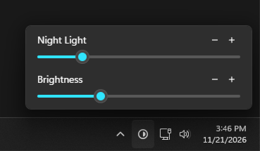

<p align="center">
  
</p>

<h1 align="center">Dusk</h1>

<p align="center">Night Light and HDR brightness sliders in the Windows 11 system tray.</p>

<p align="center">
  
</p>

Windows 11 Quick Settings has no slider for Night Light strength or for HDR "SDR content brightness", and it has no extension API for third-party apps to add one. Dusk puts both in a small tray panel styled like Quick Settings.

## Features

- **Night Light** strength and **HDR SDR content brightness** sliders, applied live while you drag
- Quick Settings look: acrylic panel, your accent colour, light/dark theme, −/+ buttons that step by 5
- Tray icon follows the taskbar theme
- Light at idle: about 6 MB of memory and no WebView2 processes; the panel is created when you hover the icon and destroyed when it closes
- Starts with Windows (toggle in the right-click menu)

## Install

```powershell
winget install ringus.Dusk
```

Or download `Dusk_x.y.z_x64-setup.exe` from [Releases](https://github.com/raajbanga/dusk/releases/latest). It installs per user, so no admin rights are needed.

To uninstall:

```powershell
winget uninstall ringus.Dusk
```

Requires Windows 11 and the WebView2 runtime (preinstalled on Windows 11). The brightness slider only appears while HDR is on.

> [!WARNING]
> Dusk relies on **undocumented** Windows APIs and registry formats. A Windows update could break it. Tested on Windows 11 build 26300 with HDR enabled.

## How it works

| Setting | Mechanism |
| --- | --- |
| HDR brightness | `DisplayConfigSetDeviceInfo` with the undocumented `SET_SDR_WHITE_LEVEL` type (`0xFFFFFFEE`), the same call the Settings app makes. Read back with `DisplayConfigGetDeviceInfo`. |
| Night Light | Rewrites the CloudStore blob at `HKCU\…\CloudStore\…\windows.data.bluelightreduction.settings`. The colour temperature is stored as kelvin × 2 after the bytes `CF 28`, the timestamp must increase on every write, and `C2 46 01` marks a live preview while dragging. Windows applies changes immediately. |
| Accent colour | `AccentPalette` in `HKCU\…\Explorer\Accent` |

Everything is plain Win32 FFI (`user32`, `advapi32`, `dwmapi`), with no extra crates. Built with Tauri 2, Preact and Tailwind CSS.

## Start with Windows

Dusk turns this on the first time it runs. Toggle it with **Start with Windows** in the tray icon's right-click menu. It is stored as a `Dusk` value under `HKCU\Software\Microsoft\Windows\CurrentVersion\Run`, and uninstalling removes it.

## Build

Requires [Rust](https://rustup.rs) with the MSVC Build Tools, and [Bun](https://bun.sh).

```powershell
bun install
bun tauri dev      # run in development (does not register autostart)
bun tauri build    # NSIS installer in src-tauri/target/release/bundle/nsis
```

## License

[MIT](LICENSE)
